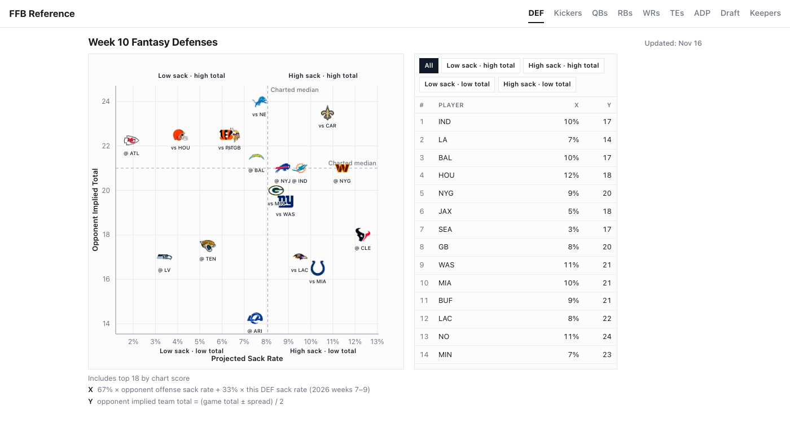
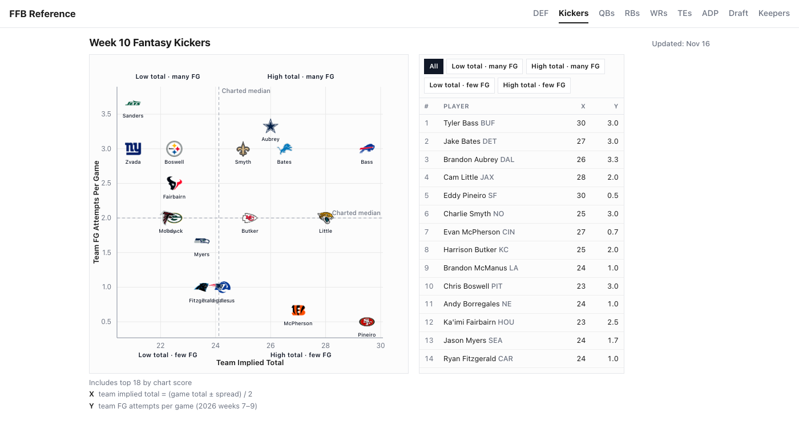
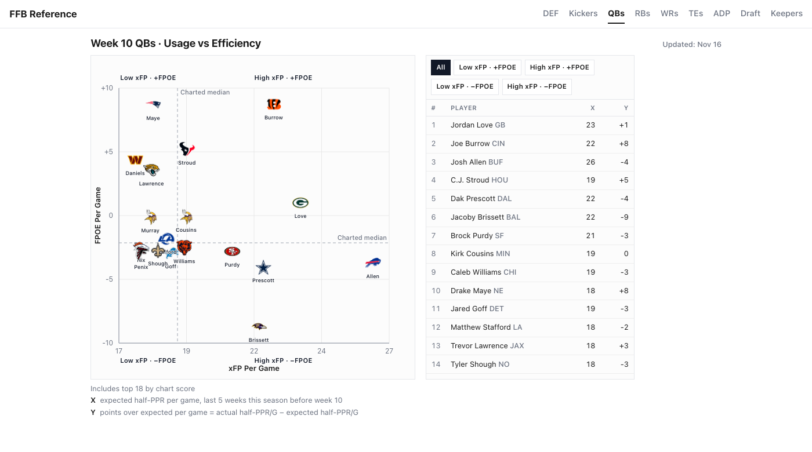
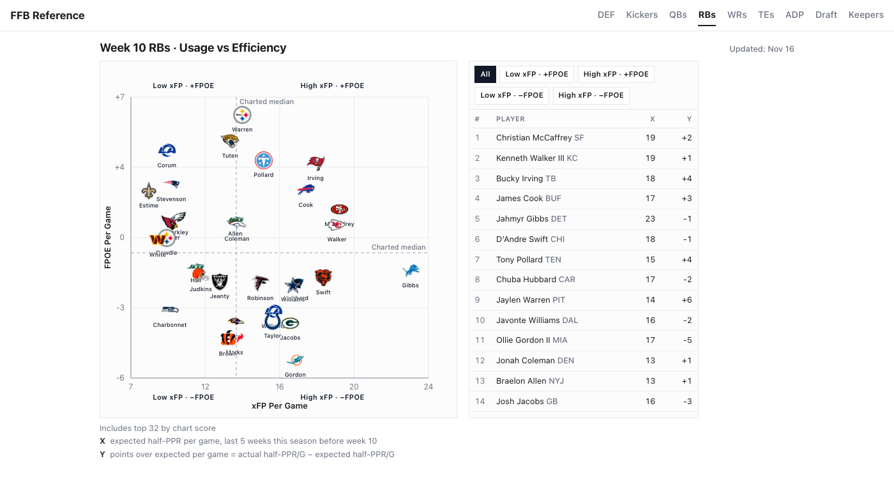
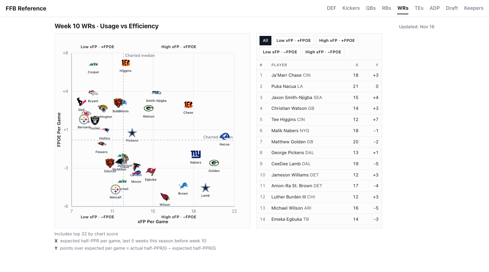
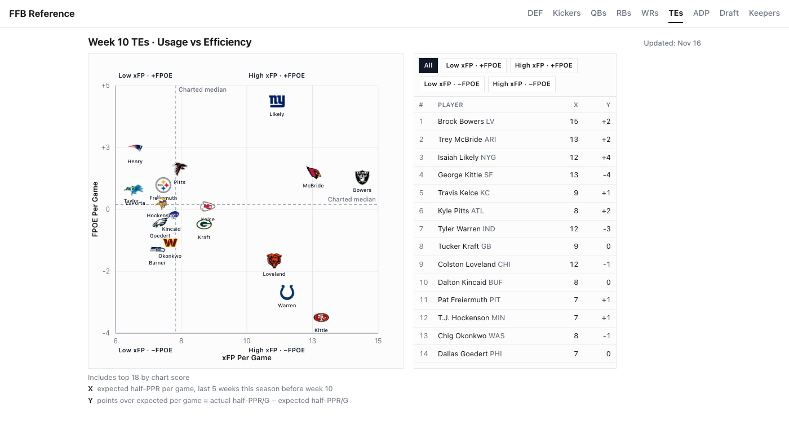

# fantasy-tool

**Live site: https://kieranaston.github.io/fantasy-tool/**

A fantasy football reference site that picks weekly waiver streamers, shows draft ADP, assists live drafts, and ranks keepers. A Python pipeline builds the data each day and publishes it as JSON to a static site on GitHub Pages. No server needed.

## Screenshots

| Defense | Kickers |
|---|---|
|  |  |
| **Quarterbacks** | **Running backs** |
|  |  |
| **Wide receivers** | **Tight ends** |
|  |  |

## What it does

**Streamers** (DEF, K, QB, RB, WR, TE): a scatter chart plus ranked list for each position, showing who to pick up this week.

- Each player gets a score from a weighted percentile of two axes. The top of the board is shown (top 18 for QB, TE, DEF and K; top 32 for RB and WR).
- QB, RB, WR and TE plot the last 5 weeks of expected points per game against points over expected (usage 90%, efficiency 10%).
- DEF plots projected sack rate against the opponent's implied total (opponent total 80%, sack rate 20%).
- K plots team implied total against team field goal attempts per game over the last 3 weeks (implied total 80%, FG rate 20%).
- Anyone who hasn't played in the last 2 weeks is dropped, so an injured player can't chart on a stale game.
- Weights were tuned with a backtest (next-week Spearman correlation, trained on 2021–24 and checked on 2025). See `src/analysis/chart_weight_backtest.py` and `chart_param_sweep.py`.

**ADP**: Sleeper ADP board with format (Half PPR, Full PPR, Standard), position and team filters.

**Draft**: live draft assistant. Paste a Sleeper draft link to get best-available picks (VORP blended with ADP, optional FantasyPros ECR sort), your roster and recent picks.

**Keepers**: ranks a Sleeper league's keepers by FantasyCalc value minus the value of the pick at the cost round, with two-year eligibility rules.

## How it works

```
docs/           published site + JSON (GitHub Pages)
data/           pipeline state (not published)
src/            Python loaders and builders
tests/          pytest suite
.github/        scheduled refresh workflows
```

Data comes from Sleeper (players, projections, ADP, leagues), nflverse and ffopportunity (usage and expected points), FantasyCalc (trade values) and FantasyPros (optional rankings). GitHub Actions refresh it on a schedule:

| Workflow | Schedule |
|----------|----------|
| Refresh streamers | Daily 15:00 UTC |
| Refresh player values | Daily 14:00 UTC |
| Refresh ADP | Manual only |

## Run locally

Python 3.10+.

```bash
python -m venv .venv && source .venv/bin/activate
pip install -e .

python -m src.run_streamers
python -m src.run_adp              # manual; season ADP is frozen unless needed
python -m src.run_fp_rankings      # optional: FantasyPros CSV → docs/data/draft/
python -m src.run_trade_values     # FantasyCalc trade values → docs/data/trade/
python -m http.server 8000 --directory docs
```

Then open http://localhost:8000.

## Tests

```bash
pip install -e ".[dev]" && ruff check src tests && pytest
```

## Deploy

GitHub Pages serves branch `main`, folder `/docs`.
